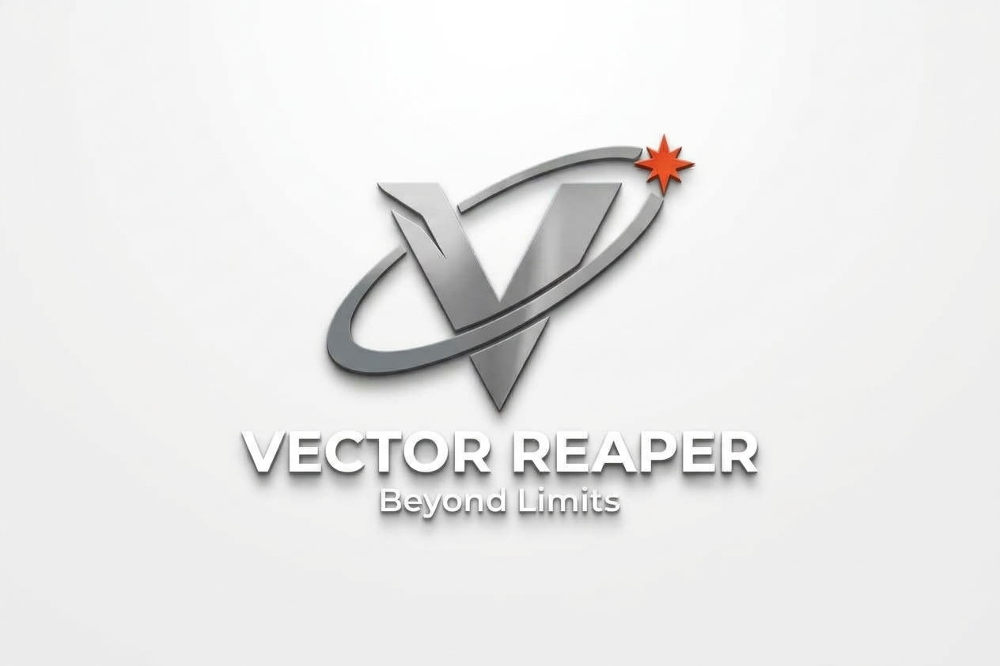

# VECTOR REAPER

### Turning Data into Discovery

Welcome to the official repository of **VECTOR REAPER**, a student-led team participating in the **NASA Space Apps Challenge 2026**.

---

## About the Team

VECTOR REAPER is a team passionate about aerospace, Earth science, data analysis, artificial intelligence, and innovative problem-solving.

Our mission is to transform data into meaningful discoveries and develop technology-driven solutions for real-world challenges.

---

## Challenge

### Be An Earth System Trend Detective!

For the NASA Space Apps Challenge 2026, we are exploring how NASA Earth observation data can help identify environmental trends, reveal hidden patterns, and support a better understanding of our planet.

---

## Areas of Interest

- Earth Observation
- Environmental Data
- Data Analysis
- Artificial Intelligence
- Data Visualization
- Climate Science
- Scientific Research
- Software Development

---

## Team

### Sarp Akar
**Founder & Team Lead**

### Murathan Akar
**Team Member**

### Beren Akar
**Team Member**

---

## Team Identity

**Team Name:** VECTOR REAPER

**Tagline:** *Turning Data into Discovery*

---

## Project Status

🚧 **Project in Development**

The challenge solution, datasets, analyses, code, visualizations, and final presentation materials will be published here during and after the NASA Space Apps Challenge 2026.

Current Phase:

✅ Project Design
✅ Documentation
✅ Dashboard Concept
✅ Sample Dataset Integration

🟡 Environmental Data Analysis
🟡 NASA Data Integration
🟡 AI Insight Generation

---

# Current Project Concept

## EarthPulse AI

### Detecting Environmental Trends Before They Become Problems

EarthPulse AI is the concept being developed by VECTOR REAPER for the NASA Space Apps Challenge 2026.

The project aims to use NASA Earth observation data to identify environmental changes, detect emerging trends, and transform complex datasets into accessible insights.

By combining Earth science, data analysis, visualization, and artificial intelligence, EarthPulse AI seeks to help users understand how environmental conditions evolve over time and where potential risks may be developing.

---

## Project Objectives

- Detect environmental trends
- Analyze Earth observation datasets
- Visualize environmental change
- Generate AI-assisted insights
- Improve public understanding of climate and environmental data

---

## Core Areas

- Earth Observation
- Climate Science
- Artificial Intelligence
- Data Analysis
- Data Visualization
- Scientific Research

---

## Expected Deliverables

- Interactive Dashboard
- Environmental Trend Visualizations
- Risk Assessment System
- AI-Generated Explanations
- NASA Data Integration

---

## Repository Structure

```text
Vector-Reaper-SpaceApps-2026
│
├── datasets
├── docs
├── presentation
├── visualizations
├── images
└── README.md

```
## License

MIT License

## Project Milestones

✅ Team Formation

✅ Challenge Selection

✅ Project Proposal

✅ System Architecture

✅ Data Source Research

✅ Dashboard Design

✅ Environmental Risk Modeling

🟡 Data Integration

🟡 Trend Detection Engine

🟡 Interactive Prototype

🟡 Final NASA Space Apps Submission


VECTOR REAPER

Turning Data into Discovery 
